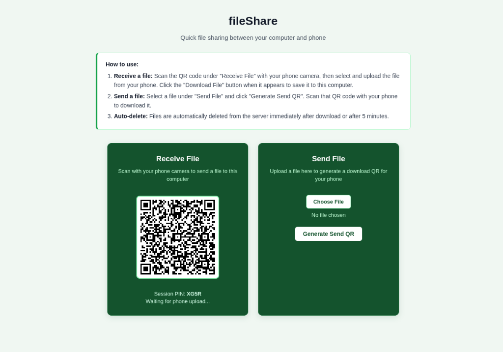

# fileShare



A lightweight, ephemeral file-sharing web application built with Go and Vanilla JS. Transfer files between computers and mobile devices using 4-character PINs and QR codes.

No accounts or mobile apps required. Files are deleted immediately after download or after 5 minutes.

---

## Features

- **QR Code Handshake**: Scan a QR code on your computer screen with your phone camera to send or receive files.
- **Burn-After-Reading**: Files are deleted from server disk immediately upon download.
- **5-Minute Auto-Expiry**: A background worker purges unclaimed files every 30 seconds after 5 minutes.
- **60 MB File Limit**: Uploads are streamed directly to disk and capped at 60 MB.
- **Passkey Protection (`AUTH_KEY`)**: Protect your server from strangers or spam. QR codes inherit the passkey automatically so mobile users never need to type it.
- **Zero External Go Dependencies**: Built entirely with the Go standard library.

---

## Quick Start (Run Locally)

### Prerequisites
- Go 1.22+

```bash
git clone https://github.com/yanaix10/fileShare.git
cd fileShare
go run main.go
```

Open `http://localhost:8080` in your browser.

---

## Free Cloud Deployment

### Render (Recommended, Free, No Credit Card Required)

1. Sign up on [Render.com](https://render.com) using your GitHub account.
2. Click **New +** > **Web Service**.
3. Select your `fileShare` repository.
4. Set the runtime to **Docker** and select the **Free** instance type.
5. (Optional) Under **Environment Variables**, add:
   - `AUTH_KEY` = `your-password` (sets a password for your server; leave empty for open access)
   - `PORT` = `8080`
6. Click **Create Web Service**. Render gives you a free HTTPS link (e.g. `https://fileshare-xyz.onrender.com`).

---

## Self-Hosting with Docker (For VPS or Home Servers)

If you have your own Linux server (like a DigitalOcean Droplet, AWS EC2, or a home Raspberry Pi), you can run fileShare in a Docker container:

```bash
docker build -t fileshare .
docker run -d -p 8080:8080 -e AUTH_KEY="your-password" --name fileshare fileshare
```

Using Docker Compose (`docker-compose.yml`):
```yaml
services:
  fileshare:
    build: .
    ports:
      - "8080:8080"
    environment:
      - PORT=8080
      - AUTH_KEY=your-password
    restart: unless-stopped
```

---

## Anti-Spam & Passkey Protection

If you host your server publicly, you can prevent strangers and bots from uploading files:

- Set the `AUTH_KEY` environment variable to any PIN or password (e.g. `1234` or `mySecretPass`).
- When visitors open your website, they must enter this passkey once to upload or download.
- When your computer generates a QR code, the passkey is automatically embedded into the link so your phone never has to type the password.
